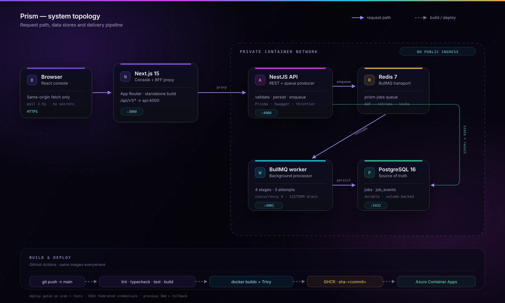
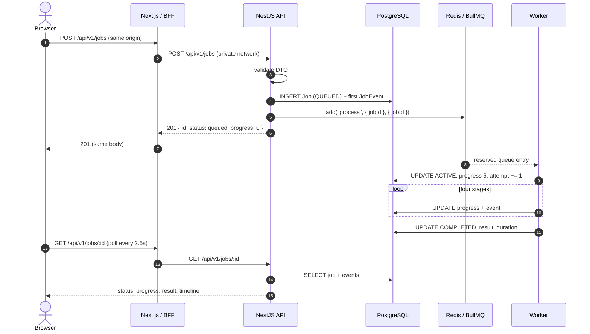
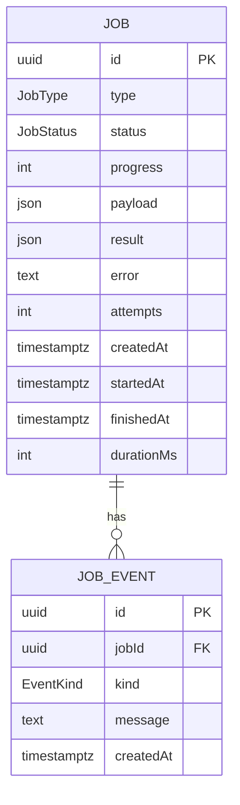
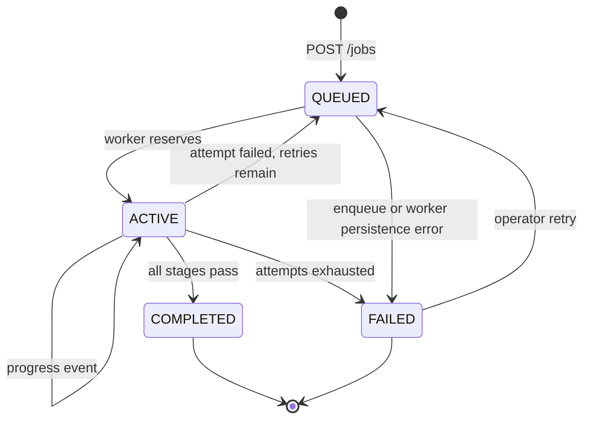
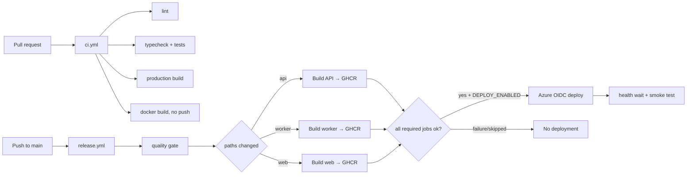

# Prism architecture

This document explains how the system is put together, why the boundaries sit
where they do, and what happens when a component fails. The diagram below is
also served at `/architecture` and lives in
[`apps/web/public/architecture.svg`](apps/web/public/architecture.svg).



## 1. Context

Prism is a single-tenant demo of an async job platform. It has five runtime
components and two data stores:

| Component           | Responsibility                                                | State         |
| ------------------- | ------------------------------------------------------------- | ------------- |
| **Web** (Next.js)   | marketing site, console, same-origin BFF, web health          | stateless     |
| **API** (NestJS)    | validation, auth-free demo intake, job reads/retries, metrics | stateless     |
| **PostgreSQL**      | source of truth for jobs, events, results                     | durable       |
| **Redis**           | BullMQ transport, stalled detection, retry scheduling         | ephemeral-ish |
| **Worker** (BullMQ) | workload execution, progress persistence, failure reporting   | stateless     |

The important boundary: **Postgres is the truth and Redis is the queue**.
Operators can inspect a job, its result and its full timeline even if Redis is
flushed. Redis is not asked to be a database.

## 2. Request and processing flow



### Why write to Postgres before Redis?

An enqueue can fail. If the API published to Redis first and the database write
failed, the worker would process a job that does not exist. Doing the durable
write first gives a clear recovery rule:

- database write fails → return an error, no queue entry;
- enqueue fails → update the row to `FAILED` with an explanatory event, then
  return `503`.

The worst case is a queued row that never gets an entry, and the API resolves
that immediately rather than leaving it silently stuck.

### Why a BFF instead of CORS?

The browser only talks to `https://<web-host>/api/v1/*`. The Next.js route handler
forwards to `API_INTERNAL_URL`, which is a private Container Apps ingress URL in
the cloud and `http://api:4000` in Compose.

Benefits:

- no CORS or preflight complexity for the console;
- the API can stay internal;
- the API hostname can change without a web rebuild;
- the web health endpoint proves the whole path, not just that Next.js is up.

The BFF forwards only the method, JSON content type, request ID and body. It
returns the upstream status and body unchanged, sets `cache-control: no-store`
and translates transport failures into a structured `502`.

## 3. Data model



Prisma stores enums in uppercase (`QUEUED`, `ACTIVE`, `COMPLETED`, `FAILED`), while
the HTTP contract uses lowercase. The mapper in `apps/api/src/jobs/jobs.mapper.ts`
is the only translation layer; changing the database enum does not leak into the
UI.

`payload` is the validated input (`label`, `records`). `result` is the
deterministic synthetic output. `JobEvent` is append-only: lifecycle,
progress, warning and error entries form the timeline shown in the drawer.

Indexes are on `status`, `createdAt` and `jobId` to support the console filters,
newest-first list and event lookup.

## 4. Job state machine



BullMQ owns retry scheduling. The database mirrors the state so the console can
show the outcome without querying Redis. `markFailure` checks
`attemptsMade < maxAttempts`: until the final attempt, the row returns to
`QUEUED` with a warning event; after that it becomes `FAILED` permanently.

## 5. Worker execution

The worker is a separate Node process. It does not import NestJS, which keeps its
memory footprint and startup time small.

```text
Worker start
  ├─ validate env
  ├─ connect Prisma + ioredis
  ├─ start health server on :4001
  └─ new BullMQ Worker(queue, processBullJob, {
       concurrency: 4,
       lockDuration: 30s,
       stalledInterval: 30s,
       maxStalledCount: 2
     })

processBullJob
  ├─ load Job row (fail loudly if missing)
  ├─ mark ACTIVE + attempt event
  ├─ run deterministic workload (4 stages)
  │    └─ each stage: UPDATE progress + INSERT event
  ├─ mark COMPLETED with result + duration
  └─ update BullMQ progress
```

### Crash semantics

BullMQ holds a renewable lock while a job runs. If the worker process is killed,
the lock expires and the stalled checker re-delivers the job. The row may remain
`ACTIVE` briefly during that window; when the job is re-delivered, the worker
increments `attempts` and restarts the stages.

`maxStalledCount = 2` prevents a job that repeatedly crashes the worker from
looping forever. After that it fails and can be replayed from the console.

The synthetic workloads are deterministic (seeded from the job id and payload),
so an at-least-once repeat produces the same result. No external side effects are
performed.

### Graceful shutdown

On SIGTERM/SIGINT the worker:

1. stops accepting new jobs via `worker.close()`;
2. waits for in-flight jobs (Docker gives it 30 seconds);
3. closes the health server, Prisma and Redis;
4. exits zero.

Compose uses `init: true` and a 30-second `stop_grace_period`; Container Apps
sends SIGTERM before replacing a revision.

## 6. Failure matrix

| Failure                  | User impact                                                                                    | Recovery                                                                 |
| ------------------------ | ---------------------------------------------------------------------------------------------- | ------------------------------------------------------------------------ |
| **Web container down**   | public site/console unavailable                                                                | Container Apps restarts it; jobs continue processing                     |
| **API down**             | BFF returns `502`; console shows a banner                                                      | orchestrator restarts; queued jobs continue                              |
| **Redis down**           | readiness `503`; new jobs are marked `FAILED` with an error event; workers cannot reserve work | restore Redis; retry failed jobs; Postgres history is intact             |
| **Postgres down**        | readiness `503`; API errors; worker retries                                                    | restore database; worker retries; timeline persists when writes resume   |
| **Worker crash mid-job** | job is temporarily `ACTIVE`, then re-delivered                                                 | BullMQ stalled detection; attempts increment; final failure after policy |
| **Migration failure**    | migrate container exits non-zero; API never starts                                             | fix migration, rerun Compose / deployment job                            |
| **Bad image/deploy**     | new revision unhealthy; readiness keeps traffic off it                                         | Container Apps keeps previous revision; traffic rollback                 |
| **Redis flush**          | queue entries lost; job rows stay in Postgres                                                  | failed/queued rows are visible; re-enqueue/retry manually                |

The system prefers **loud failure over silent loss**. A job with no durable row is
never processed; a job that cannot be enqueued is not left queued forever.

## 7. Health model

| Endpoint                        | Semantics                                     | Used by                              |
| ------------------------------- | --------------------------------------------- | ------------------------------------ |
| `GET :4000/api/v1/health`       | process alive + dependency summary            | liveness, dashboards                 |
| `GET :4000/api/v1/health/ready` | `200` only when Postgres **and** Redis answer | API routing, Compose, Container Apps |
| `GET :4001/health/ready`        | worker process + Redis + Prisma               | worker health check                  |
| `GET :3000/api/health`          | web can reach the API health endpoint         | web health check                     |

`/api/health` intentionally returns the API's dependency report, not a static
`ok`, so a broken API is visible from the public ingress.

## 8. CI/CD design



### No unnecessary rebuilds

`dorny/paths-filter` marks each service independently. A web-only change builds
only the web image. Any change to `packages/contracts`, the root lockfile or the
root package manifest fans out to all three because the images share those inputs.
Docker Buildx uses GitHub Actions cache per service.

### No deploy after failure

The deploy job has `needs: [validate, changes, build_api, build_worker, build_web]`
and an explicit `if` that rejects any failed build, a cancelled run, or a failed
quality gate. A skipped service is allowed only when its path filter is false.

### Image identity

- Immutable: `sha-<full commit SHA>`
- Convenience: `latest` on the default branch
- Deployment uses the immutable tag, never `latest`
- Trivy blocks critical vulnerabilities (unfixed ignored)
- Provenance and SBOM attestations are attached by Buildx

### Rollback

Container Apps keeps revisions. The deployment job records active revisions in
the GitHub step summary. Rollback options:

```bash
# instant traffic shift
az containerapp ingress traffic set --name <app> --resource-group <rg> \
  --revision-weight <previous-revision>=100

# or redeploy the previous immutable image
az containerapp update --name <app> --resource-group <rg> \
  --image ghcr.io/<owner>/prism-api:sha-<previous-sha>
```

Database migrations are the exception. Use expand/contract migrations so the
previous application revision can still read the schema during a rollback.

## 9. Cloud topology (Azure)

```text
Internet
  │ HTTPS
  ▼
Container App: web (external ingress :3000)
  │ HTTPS, internal ingress
  ▼
Container App: api (internal :4000)
  ├──────────────► PostgreSQL Flexible Server (private-ish public endpoint in demo)
  └──────────────► Azure Managed Redis (TLS, access key)
                          ▲
                          │ BullMQ
Container App: worker (no ingress) ──► PostgreSQL
```

All three apps live in one Container Apps environment and share its Log Analytics
workspace. The worker has no ingress, and the API is internal-only. Postgres and
Redis are managed services; the demo uses public endpoints with TLS and an
Azure-services firewall rule to keep cost and setup simple. The Terraform README
documents the Private Link/VNet hardening path.

Images are pulled from GHCR. If packages are private, Container Apps uses a
registry credential stored as a secret. Terraform injects `DATABASE_URL` and
`REDIS_URL` as Container App secrets, not plain environment values.

## 10. Configuration and secrets

| Variable               | API | Worker | Web        | Notes                                 |
| ---------------------- | --- | ------ | ---------- | ------------------------------------- |
| `DATABASE_URL`         | yes | yes    | —          | secret in cloud                       |
| `REDIS_URL`            | yes | yes    | —          | secret in cloud; `rediss://` on Azure |
| `API_PORT`             | yes | —      | —          | defaults to 4000                      |
| `WORKER_PORT`          | —   | yes    | —          | 4001                                  |
| `WORKER_CONCURRENCY`   | —   | yes    | —          | 4                                     |
| `JOB_STAGE_DELAY_MS`   | —   | yes    | —          | observability delay only              |
| `FRONTEND_ORIGIN`      | yes | —      | —          | comma-separated allowed origins       |
| `API_INTERNAL_URL`     | —   | —      | yes        | private API URL                       |
| `NEXT_PUBLIC_SITE_URL` | —   | —      | build-time | canonical metadata                    |
| `LOG_LEVEL`            | yes | yes    | —          | info in production                    |

Secrets never enter the repository or image layers:

- local: `.env` (git-ignored), Compose environment;
- CI: GitHub secrets/vars, OIDC federation, `GITHUB_TOKEN` scoped to packages;
- cloud: Container App secrets, Terraform state encrypted at rest;
- no long-lived Azure credentials in GitHub.

## 11. Scaling and capacity

- **Web** is stateless; scale replicas horizontally. The console holds no server
  session state.
- **API** is stateless; Postgres and Redis are the shared dependencies. Use a
  connection pooler (PgBouncer) before increasing replicas significantly.
- **Worker** scales independently. Concurrency is per replica; keep an eye on
  Postgres connections (`replicas × concurrency + API pool`).
- **Redis** uses `noeviction`. Never let the queue evict keys; monitor memory and
  scale the cache or move to a larger SKU.
- **Postgres** starts on a burstable B1ms for the demo. Production should right-size
  and add read replicas only if read traffic demands it.
- The queue is not partitioned per tenant; a real multi-tenant build would add
  tenant keys, fairness and per-tenant rate limits.

## 12. Observability

- API request logs include `req.id`, method, URL, status and duration.
- The BFF forwards/generates `X-Request-Id`, making it possible to correlate a
  browser request with an API log entry.
- Worker logs are structured JSON with `jobId`, type, attempt and error.
- Job events are the business-level audit log; they survive process restarts.
- `/api/v1/queue/stats` combines Redis queue counts with Postgres aggregates and
  is the source for the console cards.
- Container Apps forwards stdout/stderr to Log Analytics. Recommended alerts:
  API 5xx rate, readiness failures, queue depth growth, worker restart count,
  Redis memory, Postgres connections, failed-job rate.

## 13. Deliberate trade-offs

| Decision                                  | Why                                        | Cost                                       |
| ----------------------------------------- | ------------------------------------------ | ------------------------------------------ |
| Same-origin BFF                           | no CORS, private API, easy deployment      | one extra network hop                      |
| Postgres first, Redis second              | durable truth, explicit failure handling   | a row can briefly exist before queue entry |
| Stateless worker + deterministic workload | safe at-least-once retries                 | workload is synthetic                      |
| Polling rather than WebSockets            | simple, robust, works through any ingress  | 2.5s freshness, no push                    |
| No auth in demo                           | focuses the assessment on DevOps           | not multi-tenant                           |
| GHCR public images                        | no registry credential needed for the demo | private packages need extra setup          |
| Terraform public DB endpoints             | cheap and quick to review                  | needs Private Link for production          |
| Managed Azure services                    | less operational surface                   | fixed cost, provider coupling              |

## 14. What I would build next

1. Authentication and per-tenant job isolation (OIDC + row-level authorization).
2. Private networking for Postgres/Redis and ACR with managed identity.
3. WebSocket/SSE progress instead of polling; keep polling as fallback.
4. Dead-letter queue and scheduled jobs.
5. OpenTelemetry traces across BFF → API → queue → worker.
6. Alert rules and dashboards as code.
7. Multi-region disaster recovery and tested restore drills.
