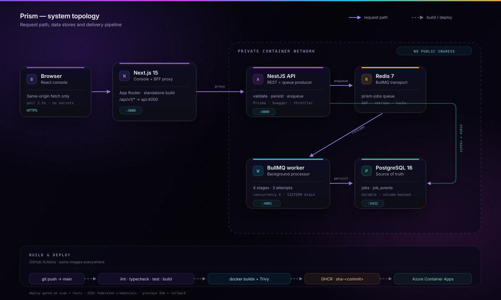

# Prism — async jobs without the background noise

Prism is a production-shaped async job platform built for the **VEGAH DevOps &
Cloud Intern practical assessment**. A Next.js console dispatches work through a
same-origin BFF to a NestJS API, which validates the request, writes the job to
PostgreSQL and publishes it to Redis with BullMQ. A separate worker process picks
it up, reports four observable stages, retries failures with exponential backoff
and persists the final result.

Everything in the request path is real. The workload itself is synthetic,
deterministic and designed to be safe to run anywhere.

- **Local console:** `http://localhost:3000/console`
- **Architecture map:** `http://localhost:3000/architecture`
- **API docs (local):** `http://localhost:4000/api/docs`
- **Public deployment:** <https://prism-prod-8ad8a0-web.delightfulcoast-e1bb1849.malaysiawest.azurecontainerapps.io>
  (Azure Container Apps, `malaysiawest`) — provisioned with Terraform and
  deployable through the gated release workflow.

## What it demonstrates

| Assessment requirement                 | Where it lives                                                           |
| -------------------------------------- | ------------------------------------------------------------------------ |
| Containerised frontend, API and worker | `apps/*/Dockerfile`, multi-stage, non-root                               |
| PostgreSQL + Redis via Compose         | `docker-compose.yml`, named volumes, health checks                       |
| Redis-backed async workflow            | BullMQ producer in the API, separate consumer in `apps/worker`           |
| Status and result API                  | `GET /api/v1/jobs/:id`, `POST /api/v1/jobs`, `GET /api/v1/queue/stats`   |
| Crash and retry handling               | BullMQ stalled-job recovery, 3 attempts with backoff, persisted timeline |
| CI/CD with no deploys on failure       | `.github/workflows/ci.yml`, `release.yml`, `needs`-gated deploy          |
| SHA image tags and registry push       | `.github/workflows/_image.yml` → GHCR                                    |
| Secrets management                     | env injection, Compose env, Terraform Container App secrets, GitHub OIDC |
| Persistence and rollback               | Postgres is source of truth; immutable Container Apps revisions          |
| Cloud deployment                       | `infra/azure` (Terraform) + deployment runbook                           |
| Architecture diagram                   | `apps/web/public/architecture.svg`, `/architecture` page                 |
| Documentation                          | this README, `ARCHITECTURE.md`, `infra/azure/README.md`, `SECURITY.md`   |

## Stack

- **Web:** Next.js 15.5 (App Router), React 19, Tailwind CSS 4
- **API:** NestJS 11, Prisma 6, class-validator, Swagger, Pino, Helmet, throttling
- **Queue:** BullMQ 5 on Redis 7, `noeviction`, AOF persistence in Compose
- **Worker:** standalone Node process with graceful SIGTERM and a health server
- **Database:** PostgreSQL 16, Prisma migrations, job + event tables
- **Runtime:** Node 22 Alpine, Docker Buildx, multi-stage images, non-root users
- **CI/CD:** GitHub Actions → GHCR → Azure Container Apps (OIDC, SHA tags, Trivy)
- **Infrastructure:** Terraform (`azurerm` 4.x), Container Apps, PostgreSQL
  Flexible Server, Azure Managed Redis, Log Analytics

## Architecture



The request path is intentionally one-way and boring:

```text
Browser
  └─ same-origin fetch
      └─ Next.js BFF (/api/v1/*)
          └─ NestJS API
              ├─ PostgreSQL  ← job row + event, written first
              └─ Redis/BullMQ ← queue entry only
                                  └─ Worker
                                      ├─ stage progress → PostgreSQL
                                      ├─ timing/backoff → BullMQ
                                      └─ result → PostgreSQL
```

Redis is transport, **not** the source of truth. A cache flush can lose queue
state; it cannot rewrite the job history in Postgres. The console polls the API
every 2.5 seconds unless the tab is hidden or the operator pauses polling.

See [`ARCHITECTURE.md`](ARCHITECTURE.md) for sequence diagrams, failure modes,
data model, scaling notes and trade-offs.

## Quick start

Prerequisites: Docker Desktop (or Docker Engine + Compose v2) and ~4 GB of free
disk. No local Node or PostgreSQL install is required.

```bash
docker compose up --build -d
docker compose ps
```

That one command:

1. starts PostgreSQL 16 and Redis 7 with health checks and named volumes;
2. runs `prisma migrate deploy` in a one-shot migration container;
3. starts the API only after migrations and Redis are healthy;
4. starts the worker, then the web app after the API is healthy.

Open **http://localhost:3000/console**, dispatch a job, and watch the timeline.
The first build takes a few minutes because it compiles the monorepo inside the
images. Rebuilds use Docker layer cache.

If ports `5432`, `6379`, `4000` or `3000` are already occupied, use host-side
overrides:

```bash
POSTGRES_PORT=55432 REDIS_PORT=56379 API_HOST_PORT=4400 WEB_HOST_PORT=3300 \
  docker compose up --build -d
```

The container network always uses Postgres `5432`, Redis `6379`, API `4000` and
web `3000`; only the published host ports change.

Check the stack:

```bash
curl http://localhost:3000/api/health
curl http://localhost:3000/api/v1/queue/stats
```

Run the end-to-end smoke test through the public web origin:

```bash
npm run smoke
# or against a deployment:
BASE_URL=https://prism.example.com npm run smoke
```

Tear down:

```bash
docker compose down      # keep the data volumes
docker compose down -v   # delete jobs and queue state
```

## API

All browser traffic goes to the Next.js origin. The BFF forwards to
`API_INTERNAL_URL`, so the API hostname stays private and CORS is not needed in
the browser. The API is still directly reachable on `:4000` in local development
for Swagger.

| Method | Path                                  | Purpose                                         |
| ------ | ------------------------------------- | ----------------------------------------------- |
| `GET`  | `/api/v1/health`                      | liveness + dependency summary                   |
| `GET`  | `/api/v1/health/ready`                | readiness; `503` when Postgres or Redis is down |
| `POST` | `/api/v1/jobs`                        | validate, persist and enqueue a job             |
| `GET`  | `/api/v1/jobs?status=active&limit=25` | paginated list with status filter               |
| `GET`  | `/api/v1/jobs/:id`                    | job status, events, timing and result           |
| `POST` | `/api/v1/jobs/:id/retry`              | re-enqueue a failed job                         |
| `GET`  | `/api/v1/queue/stats`                 | queue depth and aggregate metrics               |

Create a job:

```bash
curl -sS -X POST http://localhost:3000/api/v1/jobs \
  -H 'content-type: application/json' \
  -d '{"type":"insight-report","payload":{"label":"Q3 revenue pulse","records":2500}}'
```

Poll it:

```bash
curl -sS http://localhost:3000/api/v1/jobs/<id>
```

Job types and their synthetic workloads:

| Type                | What the worker actually does                                                                |
| ------------------- | -------------------------------------------------------------------------------------------- |
| `insight-report`    | validates, loads deterministic synthetic rows, aggregates segments and p95, formats a report |
| `dataset-normalize` | trims/deduplicates generated records and returns a stable checksum                           |
| `digest-render`     | groups sections, composes a digest and returns a deterministic signature                     |

The result shape is typed in [`packages/contracts`](packages/contracts/src/index.ts)
and shared by all three runtimes. Changes cannot silently drift.

## Local development without Docker

```bash
cp .env.example .env
npm install
docker compose up -d postgres redis
npm run db:migrate
npm run db:seed
npm run dev
```

`npm run dev` builds the contracts package, generates the Prisma client and runs
the API, worker and web app concurrently. The seed inserts a small set of
completed and failed jobs so the console is not empty on first load.

Useful commands:

```bash
npm run lint
npm run typecheck
npm test
npm run build
npm run format
```

## Reliability model

- **At-least-once delivery:** BullMQ may deliver a job more than once. The worker
  uses a deterministic payload and idempotent writes, so a repeat run converges
  on the same result rather than duplicating work.
- **Three attempts, exponential backoff:** `2s → 4s → 8s`, configurable in
  `QueueService`.
- **Stalled-job recovery:** if the worker dies mid-job, BullMQ's stalled check
  re-delivers it after the lock expires. `maxStalledCount` bounds repeated
  crashes, after which the job is failed and can be retried by an operator.
  Verified in this build: the worker was killed at 40% progress; after restart
  the job was re-delivered as attempt 2 and completed with 11 persisted events.
  Container Apps restarts replicas automatically; Compose needs
  `docker compose start worker` after a manual `kill`.
- **Postgres before Redis:** the API writes the job and first event before
  enqueueing. If Redis is unavailable, the row is failed loudly with an error
  event rather than left queued forever.
- **Graceful shutdown:** SIGTERM waits for in-flight jobs for up to 20 seconds,
  then closes Redis/Prisma and the health server.
- **Health checks:** liveness is cheap; readiness returns `503` when either
  dependency is down. Compose and Container Apps use readiness for routing.
- **Bounded queue history:** completed entries are kept for an hour / 500 jobs,
  failed entries for a day / 500 jobs. Postgres retains the durable record.

## Security

- Non-root users, read-only root filesystems (`api`, `worker`) and `no-new-privileges`
  in Compose.
- API validation with whitelist + `forbidNonWhitelisted`; unknown fields are
  rejected.
- Helmet headers, response compression, request IDs and Pino redaction for
  authorization/cookie/password fields.
- Per-IP rate limit (120 requests/minute by default).
- No secrets in images or the repo. `.env` is ignored; Terraform injects
  Container App secrets; GitHub Actions uses OIDC rather than stored Azure
  credentials.
- GHCR images are immutable by SHA and scanned for **critical** CVEs in the
  release workflow.

Patched `multer` and `postcss` versions are pinned with npm overrides, which
cleared the advisories inherited from NestJS and Next.js. `npm audit --omit=dev`
still reports one high-severity chain: Prisma 6's CLI config parser depends on
`deepmerge-ts@7`, which has a stack-exhaustion advisory. It only runs at
migration/generate time on developer-owned config, never on request input. See
[`SECURITY.md`](SECURITY.md) for the risk assessment and upgrade path. Critical
findings fail the release workflow.

This is a demo, not a multi-tenant SaaS: there is no authentication, authorization
or per-user isolation. Do not put customer data in it as-is.

## CI/CD

```text
pull request ──► CI: lint → typecheck → test → build → audit → compose config
                     └─ Docker build (api, worker, web, no push)

push to main ──► Release: same quality gate
                     ├─ path filter: only rebuild changed services
                     ├─ Buildx → GHCR, SHA tag + latest
                     ├─ Trivy critical scan
                     └─ deploy job (gated by DEPLOY_ENABLED and successful builds)
                           ├─ Azure OIDC login
                           ├─ update only changed Container Apps revisions
                           ├─ wait for /api/health
                           └─ run the real end-to-end smoke test
```

- A failed lint, test, build or image scan stops the chain: the deploy job cannot
  run.
- `dorny/paths-filter` avoids rebuilding all three images when only one service
  changed. Root lockfile/contracts changes correctly fan out to all services.
- Images are tagged `sha-<full commit SHA>` and `latest`; deployments use the
  immutable SHA tag.
- The production environment can require a reviewer; `DEPLOY_ENABLED=false`
  keeps image publication working while disabling deployment.

## Deploy to Azure

The full runbook, including remote state, OIDC setup, registry visibility,
migration job and rollback commands, is in
[`infra/azure/README.md`](infra/azure/README.md).

At a high level:

```bash
cd infra/azure
cp terraform.tfvars.example terraform.tfvars
terraform init
terraform apply
terraform output web_url
```

Then set the GitHub repository variables from the outputs and push to `main`.
The deployment uses Container Apps revisions, so the previous revision remains
available for an instant traffic rollback.

### Live deployment

| Item | Value |
| --- | --- |
| URL | <https://prism-prod-8ad8a0-web.delightfulcoast-e1bb1849.malaysiawest.azurecontainerapps.io> |
| Region | `malaysiawest` (see [`docs/decisions.md`](docs/decisions.md) for why not `southeastasia`) |
| Resource group | `prism-prod-8ad8a0-rg` |
| Images | `ghcr.io/coderv1304/prism-{web,api,worker}:sha-287574f...` |
| Migration | `prisma migrate deploy` applied before the smoke test |

`GET /api/health` reports `database: up` and `redis: up`; the smoke test submits
a real job and waits for the worker to persist the result. CI/CD authenticates
with GitHub OIDC scoped to the resource group — no Azure credentials are stored
in the repository.

## Observability and debugging

- **Structured JSON logs** from API and worker, with request IDs and redaction.
- **Request tracing:** the BFF forwards `X-Request-Id`; the API returns it and
  logs it with each request.
- **Job timeline:** every lifecycle, progress, warning and error event is stored
  in `JobEvent`, so the drawer remains useful after the process that produced it
  is gone.
- **Queue metrics:** `GET /api/v1/queue/stats` combines BullMQ counts with
  PostgreSQL aggregates.
- **Health endpoints:** API liveness/readiness, worker health on `:4001`, web
  health that proves the BFF can reach the API.

Useful Docker commands:

```bash
docker compose ps
docker compose logs -f api worker web
docker compose exec postgres psql -U prism -d prism -c 'select id,status,progress from "Job" order by "createdAt" desc limit 10;'
docker compose exec redis redis-cli LLEN bull:prism-jobs:wait
```

## Repository layout

```text
.
├── apps
│   ├── api        NestJS REST API, Prisma schema/migrations, tests
│   ├── web        Next.js app, console, BFF, architecture page
│   └── worker     BullMQ consumer, workloads, health server, tests
├── packages
│   └── contracts  Shared types and job catalog
├── infra/azure    Terraform for Container Apps, Postgres, Redis, logs
├── scripts        Cross-platform smoke test
├── .github        CI, release, reusable image workflow, Dependabot
├── docker-compose.yml
└── ARCHITECTURE.md / SECURITY.md
```

## Demo boundaries

- The workload is synthetic. The queue, persistence, retries, progress reporting
  and status API are real.
- There is no auth or tenant isolation. The console is a single shared demo.
- The deployment runs on the cheapest sensible Azure SKUs (Burstable
  PostgreSQL, Azure Managed Redis `Balanced_B0`, scale-to-one Container Apps).
  It is a demo, not a funded production environment.
- `southeastasia` is blocked by an inherited subscription policy, so the live
  stack runs in `malaysiawest`; the trade-off is recorded in
  [`docs/decisions.md`](docs/decisions.md).

## Three-minute walkthrough script

1. **0:00–0:30** — Open `/`, scroll the system principles and the request path.
   Call out the one-command stack.
2. **0:30–1:15** — Open `/console`, show health, stats, dispatch an
   `insight-report`, then open the drawer while it runs. Point out live stages,
   event timeline and the persisted result.
3. **1:15–1:50** — Show `docker compose ps` (all healthy), `POST /api/v1/jobs`
   from the terminal and the same job appearing in the console.
4. **1:50–2:25** — Open `/architecture`, walk the BFF → API → Postgres/Redis →
   worker path, then show the release workflow: tests/builds gate deployment,
   SHA tags, path filters, OIDC and rollback.
5. **2:25–2:55** — Open the live URL and `/api/health`, then show
   `infra/azure` outputs and the release workflow: OIDC-scoped deploy,
   `DEPLOY_ENABLED`, migration step and the smoke test closing the loop.

## License

Assessment demo. No production license is implied.
